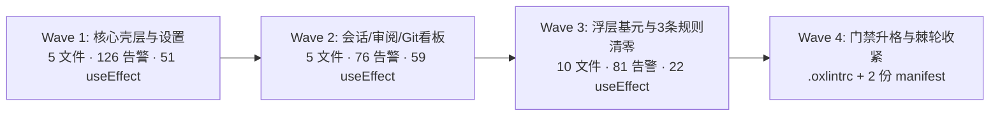

# Pidex Renderer 高风险 React 状态与副作用技术债治理实施计划

> 本计划用于指导在 Pidex（`f:\CodeProject\CodePilotX`）中集中治理 `apps/desktop/renderer/src/` 积压的高风险 React 状态与副作用技术债。
> 执行前请先阅读根目录 [`AGENTS.md`](../../AGENTS.md)、[`apps/desktop/renderer/AGENTS.md`](../../apps/desktop/renderer/AGENTS.md) 与 [`apps/desktop/renderer/src/AGENTS.md`](../../apps/desktop/renderer/src/AGENTS.md)，严格遵守副作用原语契约、分级注释纪律、棘轮基线约束与 Renderer 组件/样式规范。

## 目标概述

本次治理聚焦 Renderer 中最容易引发**状态闪烁、过期闭包、并发渲染污染、级联重渲染与竞态**的高风险 React 状态/副作用债务：

- **覆盖范围**：集中治理 **20 个高频核心与热点文件**，覆盖 Renderer 侧 **283 / 609（46.5%）** 条高风险 React lint 告警（`react-hooks(exhaustive-deps)`、`react(refs)`、`react(set-state-in-effect)`、`react(immutability)`、`react(preserve-manual-memoization)`、`react(use-memo)`）以及热点文件内的 **132 处裸 `useEffect`**（占全仓 `useEffectRatchet` 563 处的 23.4%）。
- **全仓清零 3 条低数量高危规则**（已核实 100% 集中在 Renderer 源码中）：
  - `react(immutability)`：`22 -> 0`
  - `react(preserve-manual-memoization)`：`24 -> 0`（`lint-ratchet-manifest.json` 预算 `27 -> 0`）
  - `react(use-memo)`：`10 -> 0`
- **同步大幅压降存量与副作用债**：`react-hooks(exhaustive-deps)`（`-112`）、`react(refs)`（`-94`）、`react(set-state-in-effect)`（`-21`）及 `useEffectRatchet`。
- **收尾锁定**：收紧 [`lint-ratchet-manifest.json`](../../scripts/contracts/lint-ratchet-manifest.json) 与 [`arch-contracts-manifest.json`](../../scripts/contracts/arch-contracts-manifest.json)，并在 [`.oxlintrc.json`](../../.oxlintrc.json) 将已清零的 3 条规则显式升格为 `"error"`。



---

## 0. 执行约束与架构红线（所有执行模型必读）

1. **必读规范与边界**：
   - 执行前先阅读 [`AGENTS.md`](../../AGENTS.md)、[`apps/desktop/renderer/AGENTS.md`](../../apps/desktop/renderer/AGENTS.md) 与 [`apps/desktop/renderer/src/AGENTS.md`](../../apps/desktop/renderer/src/AGENTS.md)。
   - 保持现有 workspace 划分与单向依赖边界；不得触碰 `apps/agent/`、`apps/desktop/electron/` 或 `packages/*`（除非发现纯类型问题，默认零跨端改动）。
   - 不改任何公开 Props 签名、RPC v4 契约、SQLite schema 或 `localStorage` 持久化格式；仅允许同目录或同功能域内部 Context 接口收口（`Menu.tsx` 的 `SubContext`、`Popover.tsx` 的 `PopoverContext`、`DesktopLayout.tsx` 的 `providerManagement` outlet context）。
2. **副作用原语与 `useEffectRatchet` 红线**：
   - 严格复用现有副作用原语：[`UseMountEffect.ts`](../../apps/desktop/renderer/src/hooks/UseMountEffect.ts)（`useMountEffect`）、[`UseExternalSubscription.ts`](../../apps/desktop/renderer/src/hooks/UseExternalSubscription.ts)（`useExternalSubscription`、`useWindowEvent`、`useMediaQuery`）、React 19.2 `useEffectEvent` 以及渲染期派生状态。
   - **严禁修改 [`ArchContractsCore.ts`](../../scripts/contracts/ArchContractsCore.ts) 中的 `isRawUseEffectExempt` 白名单**。
   - **严禁新建文件承载裸 `useEffect`**：`useEffectRatchet` 按文件锁定，新文件基线为 `0`，将裸 `useEffect` 挪到新 hook 文件会直接触发 `arch:check` 报错。
   - 对确实需要“随 prop/ID 同步外部系统（DOM、Electron IPC、定时器等）”的合法 `useEffect`，保留在原文件内并用 `useEffectEvent` 与完整依赖修复闭包/竞态隐患；能消除的 `useEffect` 一律迁移或改派生状态。
3. **注释与抑制红线**：
   - 严禁使用裸 `oxlint-disable`、裸 `@ts-ignore` 或未追踪 `TODO` / `FIXME` / `HACK`。
   - 遵循分级注释契约：源码仅允许导出 API 的 JSDoc 与 `// INVARIANT:` / `// SAFETY:` 结构化不变量注释；**严禁新增普通“what”注释**，绝不抬高 `commentRatchet`。
4. **工作区与提交纪律**：
   - 不回退、不格式化无关脏文件；不擅自创建 git commit。
   - 若执行中暴露真实竞态或过期闭包 Bug，在 `apps/desktop/renderer/test/` 下补充最小必要回归单测。

---

## 1. 已对齐的核心决策

1. **治理范围**：聚焦 20 个热点文件（覆盖 ~46.5% Renderer 高风险 React 告警）+ 全仓清零 `react(immutability)`、`react(preserve-manual-memoization)`、`react(use-memo)` 3 条规则。
2. **原语边界**：严格复用现有原语，不扩大 `ArchContractsCore.ts` 豁免名单；合法且依赖动态 props/ID 的外部同步保留在原文件并收紧依赖与 `useEffectEvent`。
3. **双重防回退锁**：Wave 4 同时收紧两份棘轮清单，并在 `.oxlintrc.json` 将清零的 3 条规则升格为 `"error"`。
4. **执行节奏**：按 Wave 1 -> Wave 4 连续推进，每波完成后立即跑本波定向校验与测试，全部完成后统一过全仓门禁。

---

## 2. 6 类系统性根因与标准修复手法（P1–P6）

| 编号   | 根因模式                                        | 典型报错                                          | 标准修复手法                                                                                                                                                                                                                                                                                                               |
| ------ | ----------------------------------------------- | ------------------------------------------------- | -------------------------------------------------------------------------------------------------------------------------------------------------------------------------------------------------------------------------------------------------------------------------------------------------------------------------- |
| **P1** | `useFieldState` 稳定 setter 未列入依赖          | `exhaustive-deps` / `preserve-manual-memoization` | `useFieldState` 返回的 setter 经 `useCallback([store, key])` 稳定，将其补入依赖数组（零性能损耗）；批量初始化/重置场景（如 `UseDesktopSettings`）直接合并为单次 `stateStore.setState(patch)`。                                                                                                                             |
| **P2** | 渲染期直接读写 `ref.current`                    | `react(refs)`                                     | (a) “同步最新值给回调/Effect”改用 `useLayoutEffect` 同步或直接用 React 19.2 `useEffectEvent`；(b) “记录上次 prop 算派生值”改用渲染期状态调整（`useState` 记录 `[prevProp, derived]`）；(c) 惰性单例改用 `useState(() => create())`；(d) 渲染期读取 DOM 尺寸（如 `Popover` 箭头坐标）迁入 `useLayoutEffect` 写入 CSS 变量。 |
| **P3** | 跨组件修改 Context/Prop 中的对象或 Ref          | `react(immutability)`                             | Provider 暴露稳定注册/设置方法（`registerBeforeChange`、`setVirtualAnchor`、`setPointerOpened`、`setContentNode`），由拥有 ref 的组件内部修改；`MenuSubContent` 中 `parentCoord.child = next` 从 `useMemo` 移入 `useLayoutEffect`（含 cleanup 还原）。                                                                     |
| **P4** | 闭包捕获下方声明（TDZ）与自递归                 | `react(immutability)`                             | 调整声明顺序，将 `useState` / `useCallback` / 辅助函数提升至消费方之前；自递归 `requestAnimationFrame` 循环（`UseComposerDictation.drawWaveform`）拆为内部具名 `tick` 递归函数。                                                                                                                                           |
| **P5** | `useMemo` 非内联函数或复杂下标依赖              | `react(use-memo)`                                 | `useMemo(fn, [])` 改为 `useMemo(() => fn(), [])` 或 `useState(fn)[0]`；将 `committedDraftValues['desktop.voice.*']` 等下标表达式提为简单局部变量或直接依赖对象。                                                                                                                                                           |
| **P6** | Effect 内同步 `setState` 与可消除裸 `useEffect` | `set-state-in-effect` / `useEffectRatchet`        | (a) 随路由/ID 重置状态改为按作用域 key 派生或渲染期条件复位；(b) 异步加载前同步清空旧值改为按 `requestKey` 绑定结果对象，过期 key 自动忽略；(c) 仅挂载执行迁至 `useMountEffect`；(d) `window` 事件监听迁至 `useWindowEvent`。                                                                                              |

---

## 3. 分波次详细实施步骤

### Wave 1：核心壳层与设置状态（5 文件 · 126 处告警 · 51 处裸 `useEffect`）

#### 3.1 `apps/desktop/renderer/src/features/layout/shell/DesktopLayout.tsx`

- **当前债项**：64 处高风险告警（29 `exhaustive-deps`、22 `preserve-manual-memoization`、6 `refs`、5 `set-state-in-effect`、2 `immutability`）+ 26 处裸 `useEffect`。
- **具体改造**：
  1. **消除 2 处 `immutability`（P4）**：将 `pendingSubmissions` 与 `setReviewTabState` 声明提升至 L927 `useLayoutEffect` 与 L1402 `handleOpenPatchReview` 之前，并补齐 L927 缺失的 `pendingSubmissions` 依赖。
  2. **消除 5 处 `set-state-in-effect` 并压缩裸 `useEffect`（P6）**：
     - L317-325（切换 `providerRouteId` 时用 2 个 `useEffect` 清空 `providerManagementTab` / `providerPanelTabs` / `providerPanelOpen`）：收敛为按 `providerRouteId` 作用域化状态或渲染期路由切换复位，删去这 2 处裸 `useEffect`。
     - L771-781 & L2490（`titlebarSessionTabs` 变化后又在 Effect 内 `setTitlebarTabSnapshotsById` 触发循环二次渲染）：拆离“初始只读 L1 `localStorage` 快照”与“实时解析标题”；Effect 仅负责 `writeStoredTitlebarSessionTabSnapshots(nextSnapshots)` 落盘，彻底消除 L2490 级联 `setState`。
  3. **消除 6 处 `refs`（L1827-1839，P2）**：将 `uiSnapshotRef.current = ...` 与 `attachmentPreviewTabRef.current = ...` 的渲染期写入迁入 `useLayoutEffect`（配合 `prevSessionIdRef` 更新）。
  4. **消除 22 处 `preserve-manual-memoization` 与 29 处 `exhaustive-deps`（P1/P2）**：
     - 为 `handleErrorMessage`、`handleCreateBranch`、`handleCommitOrPush`、`handleCreatePullRequest`、`handleOpenBrowser` 等 `useCallback` 补齐来自 `useFieldState` / `useWorkbenchShellController` 的稳定 setter 依赖（`setErrorMessage`、`setGitWorkflowMode`、`setBrowserState`、`setLastActiveWorkspacePath`、`setComposerAttachments`、`setRemovedWorkspaces`、`setUnavailableWorkspacePaths`、`setWorkbenchPanelState` 等）。
     - 对齐 `useMemo` 的对象/属性粒度（`currentWorkspace`、`visibleProviderTab`、`closeProviderManagement`、`renderSideChatComposer`、`resetHomeComposerModes`、`handleMaxContextTokensChange`、`session`、`maxContextTokens`、`sidebarShell`），清理多余依赖（`navigate`、`sideChatSubmitToSession`、`handleBranchSelect`、`handleCreateBranch` 等）。
     - L4438 使用 `useEffectEvent` 包装 `onUndo`；L4456 将依赖数组中的复杂表达式提取为简单局部变量。
  5. **收口内部 outlet context（P3）**：将 `providerManagement` outlet context 的 `beforeChange` 裸 ref 改为暴露 `registerBeforeChange(fn: () => Promise<boolean>): () => void`（供 Wave 3 的 `ProviderConnectionSection` 与 `ProviderModelPanel` 消费）。
  6. **迁移纯挂载 / `window` 监听 Effect（P6）**：将仅在挂载时执行或监听 `window` 的裸 `useEffect` 迁移为 `useMountEffect` / `useWindowEvent`。

#### 3.2 `apps/desktop/renderer/src/features/settings/UseDesktopSettings.ts`

- **当前债项**：30 处高风险告警（18 `exhaustive-deps`、8 `use-memo`、4 `refs`）+ 6 处裸 `useEffect`。
- **具体改造**：
  1. **消除 8 处 `use-memo` + 9 处 `exhaustive-deps`（L920, L1014-1021，P5）**：将 `committedDraftValues['desktop.voice.*']` 与 `committedDraftValues['desktop.composer_predictions']` 8 个下标表达式提取为简单局部变量（或直接依赖 `committedDraftValues`，同时补齐 L920）。
  2. **收敛 L759 / L1128 两条 70+ 字段巨型 `exhaustive-deps`（P1）**：`UseDesktopSettings` 中 70+ 设置项均由同一 `stateStore` 持有，将初始化加载（L759）与重置回调（L1128）合并为单次 `stateStore.setState({ ... })`，既将依赖收敛为 `[stateStore, ...]`，又避免初始化触发 70 次连续 Zustand 广播。注意保留各字段既有归一化逻辑（如 `setDraftValues` 中的 `shareDesktopSettingsValues`）。
  3. **消除 4 处 `refs`（L748, L1060, L1062, L1262，P2）**：
     - `draftValuesRef`（L748, L1262）直接改读 `stateStore.getState().draftValues`，移除镜像 ref。
     - `effectiveSettingsRef`（L1060）迁入 `useLayoutEffect` 同步。
     - `draftDirty = draftDirtyKeysRef.current.size > 0`（L1062）改由 `stateStore` 持有响应式 `draftDirty` 状态，修复渲染期读 ref 可能漏刷新的隐患。
  4. **补齐剩余 `useFieldState` setter 依赖**：`setCommittedDraftValues`、`setDraftValues`、`setDraftSaving` 等。

#### 3.3 `apps/desktop/renderer/src/features/layout/shell/UseWorkbenchShellController.ts`

- **当前债项**：10 处高风险告警（8 `refs`、2 `exhaustive-deps`）+ 6 处裸 `useEffect`。
- **具体改造**：
  - L254-261 的 8 条渲染期 ref 赋值统一迁入单个 `useLayoutEffect`。
  - L373 移除多余依赖 `workbenchStore`；L596 解构 `sidebarShell` 稳定方法或补入依赖。
  - 将纯挂载或 `window` 监听类 `useEffect` 迁至 `useMountEffect` / `useWindowEvent`。

#### 3.4 `apps/desktop/renderer/src/features/layout/dock/RightDockPanels.tsx`

- **当前债项**：10 处高风险告警（5 `refs`、3 `set-state-in-effect`、2 `exhaustive-deps`）+ 11 处裸 `useEffect`。
- **具体改造**：
  - L114-134（`RightDockSkillPreviewPanel`）：将 `builtin://` 分支改为渲染期派生；异步结果以 `{ requestKey, content, error }` 按 key 绑定，消除 Effect 首行同步 `setContent(null); setError(null)`。
  - L475-476 & L687-689：`useRef(readFileTreeViewState(workspacePath))` 改为惰性 `useState(() => readFileTreeViewState(workspacePath))`，避免重渲染重复读 `localStorage`。
  - L700-730：`onLoadErrorRef` + 同步 `useEffect` 改用 `useEffectEvent`（消 1 处裸 `useEffect`）；`documentScope` 用 `useMemo(() => ({ projectId, folderId }), [projectId, folderId])` 稳定化，补齐 L714 / L728 依赖。
  - L1187-1241（`EditorFileTreePresenceItem`）：`initiallyVisibleRef` 改为 `useState(visible)`；`entryComplete` 改为渲染期派生 `isPresent && (reducedMotion || entryComplete)`，同时消除 L1231 / L1240 两处 `set-state-in-effect` 与 L1238-1241 整段裸 `useEffect`。

#### 3.5 `apps/desktop/renderer/src/features/layout/SidebarFrame.tsx`

- **当前债项**：12 处高风险告警（10 `refs`、2 `exhaustive-deps`）+ 2 处裸 `useEffect`。
- **具体改造**：
  - L98-113（`previousModeRef` / `modeDurationRef` 渲染期读写）：改为 React 渲染期状态调整 `useState({ mode: shell.mode, duration: 0.3 })`。
  - L115-116（`dockedRef.current = docked`）：改为 `useEffectEvent` 或 `useLayoutEffect` 同步。
  - L135：`transition` 用 `useMemo` 稳定并补入依赖；L148 解构 `const { onFloatingResizeChange } = shell` 补齐依赖。

---

### Wave 2：会话、审阅与 Git 看板主链路（5 文件 · 76 处告警 · 59 处裸 `useEffect`）

#### 3.6 `apps/desktop/renderer/src/features/session/conversation/ConversationPage.tsx`

- **当前债项**：19 处高风险告警（15 `exhaustive-deps`、3 `set-state-in-effect`、1 `refs`）+ 13 处裸 `useEffect`。
- **具体改造**：
  - L346：`activeSessionIdRef.current = activeSessionId` 迁入 `useLayoutEffect`。
  - L353 / L595 / L852：3 处 `set-state-in-effect`（含切换 `activeSessionId` 时复位内联编辑态等）改为按 `activeSessionId` 作用域化或渲染期复位，同步减少对应裸 `useEffect`。
  - L371-375 等纯挂载/卸载清理迁至 `useMountEffect`。
  - L382 / L390：解构 `canonicalConversation` 的稳定方法 `loadAllOlder` / `loadOlder`。
  - L1072 / L1128-1131 / L1248：用 `useCallback` 稳定 `handleInlineBlur`、`handleInlineKeyDown`、`handleTitleKeyDown`，补齐缺失依赖并清理 L1248 的 9 个冗余依赖。

#### 3.7 `apps/desktop/renderer/src/features/session/composer/ComposerCard.tsx`

- **当前债项**：18 处高风险告警（14 `refs`、3 `set-state-in-effect`、1 `exhaustive-deps`）+ 8 处裸 `useEffect`。
- **具体改造**：
  - L582-584：改为派生 `const effectiveContextPreviewOpen = contextPreviewOpen && showContextUsage && Boolean(contextUsage)`，消除 `set-state-in-effect` 与该裸 `useEffect`。
  - L641-646 & L1380：将 `draftKey` / `routedSessionId` 切换复位收敛为渲染期状态调整，清理 Effect 内同步 `setState`。
  - L624 / L652 迁至 `useMountEffect`；L668 `window` `dragend`/`drop` 监听迁至 `useWindowEvent`（减少 3 处裸 `useEffect`）。
  - L685 / L688：`requestInputRef` 与 `contextScopeRef` 迁入 `useLayoutEffect` 同步。
  - L1010-1185（12 处 `react(refs)`）：提取稳定回调 `openFilePicker`（封装 `filePickerRef.current?.click()`）与 `replaceMentionAt`（封装 `editorRef.current?.replaceTextRange(...)`），解除 `useMemo` 内 ref 污点传播并补齐 L980 缺失的 `closeDropdown`、`addWorkspaceContextPath`、`setContextDirectory`。

#### 3.8 `apps/desktop/renderer/src/features/review/workspace/WorkspaceReviewSidebar.tsx`

- **当前债项**：16 处高风险告警（12 `exhaustive-deps`、4 `set-state-in-effect`）+ 22 处裸 `useEffect`。
- **具体改造**：
  - L448：在 Effect 体内先用局部常量快照 `ref.current` 再在 cleanup 中使用。
  - L366 / L756 / L773 / L1317：在严格保留 `mutationRequestTokenRef` / `activeSummaryIdentityRef` 并发序号语义的前提下，将状态重置收敛为按 `summaryIdentity` / `commentIdentity` 作用域化与派生 `effectiveSelectedPath`。
  - L1012 / L1238：移除冗余 `onReviewTabStateChange` 依赖。
  - L1323 / L1375 / L1406 / L1524：补齐 `setSelectedPath` 并使用 `useEffectEvent` 读取 `reviewTabState.scrollTop` / `summary`。
  - L1477 / L1518 / L1567 / L1571：用 `useMemo` 稳定 `files` 和 `comments` 派生数组，避免每次渲染 `[]` 新引用导致下游 `useMemo` 失效。
  - 迁移纯挂载 / `window` 监听类 `useEffect` 至 `useMountEffect` / `useWindowEvent`。

#### 3.9 `apps/desktop/renderer/src/features/git-board/GitBoardContext.tsx`

- **当前债项**：19 处高风险告警（18 `exhaustive-deps`、1 `immutability`）+ 9 处裸 `useEffect`。
- **具体改造**：
  - L166：将 `selectedReview` / `setSelectedReview` 声明提升至 `selectProject` 之前，消除 TDZ `immutability`。
  - 其余 18 处 `exhaustive-deps`：规范补齐 `useFieldState` 稳定 setter（`setState`、`setReady`、`setStorageError`、`setSelectedProjectId`、`setActiveGroupId`、`setRemoteView`、`setSelectedReview`、`setCapabilities`、`setSupportsCommitRef`、`setRepositories`、`setCommitLimitByProject`、`setSelectedRefs`、`setRefreshing`）以及 `draft` / `openGroup` 依赖。

#### 3.10 `apps/desktop/renderer/src/features/session/state/UseSessionState.ts`

- **当前债项**：4 处高风险告警（2 `refs`、1 `immutability`、1 `exhaustive-deps`）+ 7 处裸 `useEffect`。
- **具体改造**：
  - L328-330：`onErrorRef.current = onError` 与 `onOpenDrawerPermissionsRef.current = onOpenDrawerPermissions` 迁入 `useLayoutEffect`（同时解决 `immutability` 与 2 处 `refs`）。
  - L726：补齐 `effectiveGrillModeActive` 依赖。

---

### Wave 3：浮层基元与 3 条清零规则收尾（10 文件 · 81 处告警 · 22 处裸 `useEffect`）

#### 3.11 `apps/desktop/renderer/src/components/ui/Tooltip.tsx`

- **当前债项**：15 处高风险告警（14 `refs`、1 `set-state-in-effect`）+ 6 处裸 `useEffect`。
- **具体改造**（**必须严格保留冷/热交接 `warm` / `cold` 与 StrictMode 语义**）：
  - L418-431（`openSessionRef` 渲染期快照冷/热打开模式）：改用渲染期状态调整 `useState<{ prevOpen: boolean; session: TooltipOpenSession | null }>`（`provider.isWarm` 为只读外部快照，不污染 StrictMode 双渲染）。
  - `isOpenRef` 与 `ownerHandlersRef` 迁入 `useLayoutEffect` 同步（或 `useEffectEvent`）。
  - L473 `setPresentState(true)` 改为派生 `const effectivePresent = isOpen || present`（仅关闭退场阶段保持 `present`）。
  - L465-469 卸载定时清理迁至 `useMountEffect`；修复 L323 / L524 / L542 渲染期 ref 访问。

#### 3.12 `apps/desktop/renderer/src/components/ui/floating/Popover.tsx`

- **当前债项**：14 处高风险告警（10 `refs`、2 `immutability`、2 `exhaustive-deps`）+ 1 处裸 `useEffect`。
- **具体改造**：
  - L119-123：`PopoverContext` 新增 `setVirtualAnchor(node: FloatingAnchor | null)` 方法，`PopoverAnchor` 仅调用该方法（消 2 处 `immutability` + cleanup 读 ref 告警）。
  - L190-211（渲染期写 `positionRef` / `dismissAnchorRef`）与 L245-252（渲染期读 `contentRef.current?.offsetWidth` 与 `anchorElement?.getBoundingClientRect()` 计算 `--popover-arrow-x` / `--popover-arrow-y`）：统一迁入 `useLayoutEffect`，通过 `contentRef.current?.style.setProperty(...)` 写入 CSS 变量，同步消除 10 处 `refs` 与渲染期强制同步回流。
  - L230：`onOpenAutoFocus` 改用 `useEffectEvent` 包装（补齐 `exhaustive-deps` 且不重复抢焦点）。

#### 3.13 `apps/desktop/renderer/src/components/ui/floating/Menu.tsx`

- **当前债项**：7 处高风险告警（6 `immutability`、1 `refs`）+ 5 处裸 `useEffect`。
- **具体改造**：
  - L491 / L513 / L528 / L576：`SubContext` 新增 `setPointerOpened(value: boolean)` 与 `setContentNode(node: HTMLDivElement | null)` 方法，由 `MenuSub` 自身更新内部 ref（消 5 处 `immutability`）。
  - L585-589：将 `parentCoord.child = next` 从 `useMemo` 移入 `useLayoutEffect`（cleanup 时仅当 `parentCoord.child === childCoord` 才置空，消第 6 处 `immutability`）。
  - L106：消除渲染期 ref 访问。

#### 3.14 `apps/desktop/renderer/src/components/ui/floating/Primitives.tsx`

- **当前债项**：7 处高风险告警（4 `refs`、1 `preserve-manual-memoization`、1 `set-state-in-effect`、1 `exhaustive-deps`）+ 1 处裸 `useEffect`。
- **具体改造**：
  - L28：`useControllableState` 的 `currentRef` 同步迁入 `useLayoutEffect`（验证同帧连续调用 `setValue` 的去重语义不回退）。
  - L62：`Slot` 合并 `ref` 与 `childRef` 脱离 `useMemo` 误报（改用回调 ref 或独立组合辅助函数，**清零最后 1 处 `react(preserve-manual-memoization)`**）。
  - L138：`useExitPresence` 改为仅追踪 `exiting` 状态，返回值派生为 `open || exiting`，消除 Effect 内同步 `setPresent(true)`。
  - L221 / L307 / L332：消除渲染期 ref 访问，cleanup 先用局部常量快照 ref。

#### 3.15 `apps/desktop/renderer/src/features/layout/sidebar/SidebarSessionGroup.tsx`

- **当前债项**：7 处高风险告警（3 `immutability`、3 `refs`、1 `preserve-manual-memoization`）。
- **具体改造**：
  - L198-206：将 `linkSessionId`、`linkValue`、`linkError`、`linking` 声明提升至 `requestPullRequestLink` 之前（消 3 处 TDZ `immutability`）。
  - L188 / L190 / L562：`dragRef` / `sessionFallbackTitlesRef` 迁入 `useLayoutEffect` 同步，修复 L562 渲染期 ref 访问。
  - L255-260：用 `useMemo` 稳定 `getSidebarSessionDisplayGroups(...)` 结果后再计算 `extraSessionIds`（消除 `preserve-manual-memoization`）。

#### 3.16 `apps/desktop/renderer/src/features/layout/sidebar/SidebarHoverCard.tsx`

- **当前债项**：7 处高风险告警（4 `refs`、1 `use-memo`、1 `immutability`、1 `exhaustive-deps`）+ 4 处裸 `useEffect`。
- **具体改造**：
  - L64：`useMemo(createSidebarHoverCardCoordinator, [])` 改为 `useMemo(() => createSidebarHoverCardCoordinator(), [])`。
  - L94 / L95 / L154 / L190：`lockOpenRef` / `onOpenChangeRef` 迁入 `useLayoutEffect` 同步，消除渲染期 ref 访问。
  - L108：使用 `useEffectEvent` 包装 `applyOpenChange`（同时消除 TDZ `immutability` 与缺失依赖 `exhaustive-deps`）。

#### 3.17 `apps/desktop/renderer/src/features/workspace/UseWorkspaceState.ts`

- **当前债项**：8 处高风险告警（4 `refs`、2 `immutability`、2 `exhaustive-deps`）。
- **具体改造**：
  - L255-263：3 个回调 ref 迁入 `useLayoutEffect`；`refreshCoordinatorRef` 改为惰性 `useState(() => createWorkspaceRefreshCoordinator(...))`。
  - L393 / L398：将 `refreshSelectedFilePreview` 与 `refreshWorkspaceGitProjection` 提升至 `refreshWorkspace` 之前并用 `useCallback` 稳定化（同时消除 2 处 TDZ `immutability` 与 `exhaustive-deps`），补齐 L518 `setSelectedFile`。
  - L326-347：两处挂载 `useEffect` 迁至 `useMountEffect`。

#### 3.18 `ProviderConnectionSection.tsx` & `ProviderModelPanel.tsx`

- **目标文件**：
  - `apps/desktop/renderer/src/features/models/provider-management/ProviderConnectionSection.tsx`（7 告警）
  - `apps/desktop/renderer/src/features/models/provider-management/ProviderModelPanel.tsx`（4 告警）
- **具体改造**：
  - `ProviderConnectionSection.tsx:191`：`useMemo(localTimeZone, [])` 改为 `useMemo(() => localTimeZone(), [])`（**清零最后 1 处 `react(use-memo)`**）。
  - 两文件中 `panel.beforeChange.current = beforeChange` 改为调用 Wave 1 新增的 `panel.registerBeforeChange(beforeChange)` 并返回其注销函数（同时消除 3 处 `immutability` 与 4 处 cleanup 读 ref 告警）。
  - `ProviderConnectionSection.tsx:290-299`：`connectedQueryableSourceIdsRef` 与 `group?.usageSources` 改用 `useEffectEvent` 读取。

#### 3.19 `apps/desktop/renderer/src/features/session/composer/UseComposerDictation.ts`

- **当前债项**：5 处高风险告警（3 `refs`、1 `immutability`、1 `set-state-in-effect`）。
- **具体改造**：
  - L199：`drawWaveform` 内部调度拆成局部具名递归函数 `const tick = (): void => { ... }`（**清零最后 1 处 `react(immutability)`**）。
  - L74 / L101 / L448：渲染期写 ref 迁入 `useLayoutEffect` 同步。
  - L496 & L499-504：用 `useEffectEvent` 隔离卸载/切换取消动作，L499 卸载清理迁至 `useMountEffect`。

---

### Wave 4：门禁升格与棘轮收紧

1. **升级 [`.oxlintrc.json`](../../.oxlintrc.json)**：在顶层 `rules` 中显式将已全仓清零的 3 条规则设为 `"error"`：

   ```json
   "react/immutability": "error",
   "react/preserve-manual-memoization": "error",
   "react/use-memo": "error"
   ```

2. **收紧棘轮清单**：
   - 运行 `bun run scripts/contracts/CheckLintRatchet.ts --update-ratchets`，更新 [`lint-ratchet-manifest.json`](../../scripts/contracts/lint-ratchet-manifest.json)（上述 3 条规则预算彻底移除，`exhaustive-deps` / `refs` / `set-state-in-effect` 预算大幅下调）。
   - 运行 `bun run scripts/contracts/CheckArchContracts.ts --update-baseline`，更新 [`arch-contracts-manifest.json`](../../scripts/contracts/arch-contracts-manifest.json) 收紧所有已降低的 `useEffectRatchet` 计数，并确保 `commentRatchet` 未升高。

---

## 4. 关键避坑清单

1. **绝不触犯 `commentRatchet`**：修改过程中禁止新增解释“做什么”的普通注释；确实需要写理由时仅允许 `// INVARIANT:` 或导出 API JSDoc。
2. **`useLayoutEffect` 同步 ref 的时序核查**：若某 ref 会在**同一渲染周期内先于自身 `useLayoutEffect`**（例如子组件渲染期或子组件 `useLayoutEffect`）被读取，不能简单把赋值挪到父组件 `useLayoutEffect`，而应转为 state、回调参数或子传父回调。
3. **`Tooltip` 冷/热交接**：必须保证 `Tooltip.test.tsx` 与冷启动防污染语义不退化。
4. **`Popover` 首次定位**：把箭头 CSS 变量计算迁入 `useLayoutEffect` 后，需确认首次打开与窗口缩放时箭头位置无闪跳或错位。
5. **`UseDesktopSettings` 批量设置**：合并 70+ setter 为 `stateStore.setState(patch)` 时，核对 `draftDirty` 与 `shareDesktopSettingsValues` 行为与逐项 setter 完全等价。

---

## 5. 分级验证与交付验收命令

### 每波次自检（Wave 1 / 2 / 3 各自完成后立即执行）

1. **定向 Oxlint 检查**：确认本波修改文件在 6 条高风险 React 规则下告警数归 0。
2. **类型检查**：`bun run --cwd apps/desktop/renderer typecheck`
3. **对应波次回归单测**：
   - **Wave 1**：

     ```powershell
     bun test apps/desktop/renderer/test/DesktopSettingsProvider.test.tsx apps/desktop/renderer/test/SettingsFieldsAndArchives.test.ts apps/desktop/renderer/test/WorkbenchPanelState.test.ts apps/desktop/renderer/test/WorkbenchPanelContext.test.tsx apps/desktop/renderer/test/TitlebarSessionTabsState.test.ts apps/desktop/renderer/test/EffectPrimitives.test.tsx apps/desktop/renderer/test/PendingSubmission.test.tsx
     ```

   - **Wave 2**：

     ```powershell
     bun test apps/desktop/renderer/test/ComposerSurface.test.tsx apps/desktop/renderer/test/ComposerFocus.test.ts apps/desktop/renderer/test/ComposerDictationBehavior.test.ts apps/desktop/renderer/test/ConversationTitleActions.test.ts apps/desktop/renderer/test/CanonicalThreadSwitch.test.tsx apps/desktop/renderer/test/GitBoardState.test.ts apps/desktop/renderer/test/GitBoardRepository.test.tsx apps/desktop/renderer/test/GitBoardSidebar.test.tsx apps/desktop/renderer/test/ReviewRefreshCoordinator.test.ts apps/desktop/renderer/test/SessionSubmitDelivery.test.ts
     ```

   - **Wave 3**：

     ```powershell
     bun test apps/desktop/renderer/test/Tooltip.test.tsx apps/desktop/renderer/test/UiInteractionPrimitives.test.tsx apps/desktop/renderer/test/ClosedMenuPruning.test.ts apps/desktop/renderer/test/MenuSafeArea.test.ts apps/desktop/renderer/test/SidebarHoverCardHandoff.test.ts apps/desktop/renderer/test/SidebarSessionPaging.test.ts apps/desktop/renderer/test/WorkspaceRefresh.test.ts apps/desktop/renderer/test/ProviderManagementPanelState.test.ts apps/desktop/renderer/test/ProviderManagementSubscription.test.ts
     ```

### Wave 4 完成后全量验收门禁

```powershell
bun run check:quality
bun run --cwd apps/desktop/renderer test
bun run --cwd apps/desktop/renderer test:a11y
bun run build:renderer
bun run test:governance
git diff --check
```

### 建议人工抽测清单

1. 启动桌面端：快速切换会话、开关居中设置弹层、修改设置项后切换页面，确认无闪烁或未保存提示误弹。
2. 会话内打开右侧 Diff / 文件树 / 子智能体面板并拖拽调整宽度、切换会话，确认面板状态持久化与焦点正常。
3. 输入框触发 `@` / `/` 菜单、本地附件选择、上下文圆环浮层与 Tooltip 连续悬停交接，确认浮层定位与键盘焦点回归正常。
4. 在供应商市场编辑模型或连接配置时切换标签触发离开拦截弹窗，确认 `registerBeforeChange` 拦截链路正常。
