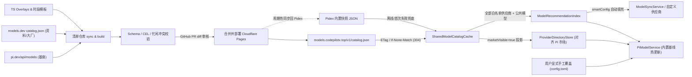

# Pidex 自维护模型清单架构与实施计划

> 目标：基于 `https://pi.dev/api/models` 基座、`models.dev` 元信息补充以及 TypeScript 声明式 Overlay 构建 Pidex 自主维护的模型清单，补齐思考强度与「忙/闲时 × 长上下文阶梯」组合计费，将供应商市场收敛对齐 Pi，并通过 Cloudflare Pages（`https://models.codepilotx.top/v1/catalog.json`）条件热更新与客户端内置快照兜底进行分发。

---

## 1. 核心设计决策

1. **托管与分发**：
   - 在独立清单仓库 `https://github.com/Pidex-Dev/pidex-model-catalog`（本地路径 `F:\CodeProject\Pidex\pidex-model-catalog`）中维护源文件，并由 GitHub Actions 通过 Direct Upload 部署至 Cloudflare Pages 项目 `pidex-model-catalog`，默认线上地址为 `https://models.codepilotx.top/v1/catalog.json`。
   - Pidex 客户端保留 `PIDEX_MODEL_CATALOG_URL` 环境变量覆盖能力，并支持 `ETag` / `If-None-Match`（`304 Not Modified`）条件拉取，避免无变更时重复下载与写盘。
   - Pidex 仓库内置一份编译时打包的静态快照作为首装离线或网络拉取失败时的兜底基线。
2. **三层数据源合成（CI 侧单源输出）**：
   - **基座层（`pi.dev`）**：从 `https://pi.dev/api/models` 拉取 Pi 官方模型目录作为基座，提供稳定厂商集合、`api`、`baseUrl`、`compat`、`thinkingLevelMap` 与最新模型列表。
   - **补充层（`models.dev`）**：从 `models.dev/catalog.json?type=all` 补全基座缺少的模型资料（`description`、`family`、`knowledge`、`release_date`、模态、基准评分、长上下文阶梯参考价）以及精选非 Pi 主流大厂。
   - **权威覆写层（TypeScript Overlay）**：显式覆盖或补充思考强度档位、特殊协议请求体映射、`Pricing` 忙/闲时与长上下文阶梯定价、以及新增/修正模型事实。
   - Pidex 客户端仅消费构建后的单一 `catalog.json`，不再在客户端直接请求 `pi.dev/api/models` 或 `models.dev`。
3. **供应商市场精选展示与全量智能配置索引解耦**：
   - 清单通过显式 `MARKET_VISIBLE_PROVIDERS` 控制「供应商市场」展示范围（首批收敛为 `deepseek`、`minimax-cn`、`minimax` 三项，覆盖 DeepSeek 及 MiniMax 国内/国际站），不再把大量未精修的供应商直接暴露到供应商市场；后续每精修一家厂商只需在 `MARKET_VISIBLE_PROVIDERS` 增加一行即可线上热放出。
   - 未进入市场的其余 Pi 供应商与精选非 Pi 主流大厂（如火山方舟、阿里云百炼、硅基流动、智谱等）以及全部主流公共模型事实（`models`）继续以 `marketVisible: false` 完整保留在 `catalog.json` 中，确保用户手动添加自定义供应商/中转站时的 `smartConfig` 模型智能配置 100% 不受影响。
   - 对已经保存过凭据或 `config.toml` 配置的旧内置供应商（如 OpenAI / Anthropic），客户端自动保留可见并正常运行，避免破坏既有用户配置；所有未配置的非市场可见内置供应商自动从供应商广场隐藏。
4. **内置 Provider 热更新与 `smartConfig` 职责分离**：
   - **内置 Provider（Pi 供应商）**：不依赖 `smartConfig`。自维护清单直接作为其上游基线；清单更新发布后，已启用模型的新规格、思考强度、单价、忙/闲时及阶梯计费规则自动热更新到运行时，仅用户在 `config.toml` 中显式手工修改过的字段保留用户值。
   - **内置 Provider 新增模型**：清单为已配置内置供应商发布全新模型时，新模型默认以 `enabled: false` 进入该供应商的可选模型与管理列表，不自动勾选进聊天模型选择器，避免下拉列表失控膨胀。
   - **`smartConfig` 职责**：仅服务于自定义供应商/中转站及用户手动新增模型，负责按模型 ID 匹配并自动填充规格与定价。
5. **思考强度双层契约**：
   - 清单以声明式模型事实为主：通过 `reasoning_options` 描述 `effort` 档位值域、`toggle` 开关、`budget_tokens` 范围及可选默认档位。
   - 常规请求体字段映射（CEL `map`）继续由 Pidex 内置规则（[`ZCodeModelOptions.ts`](../../apps/agent/src/provider/pi/ZCodeModelOptions.ts) 与 [`option-map`](../../apps/agent/src/provider/pi/option-map/compiler.ts)）统一承接，减少清单耦合；仅特殊模型允许在清单中可选附带 `option_specs.map` 进行热更新覆盖。
6. **忙/闲时 × 长上下文阶梯组合计费**：
   - 清单源文件通过 TypeScript 时段模板与折扣辅助函数复用忙/闲时规则，构建产物展开为扩展后的标准 `Model.Pricing`（在 [`Model.ts`](../../packages/model-schema/src/Model.ts) 的 `UnitPrices` 中新增可选 `tiers` 数组，支持忙时与闲时各自拥有长上下文阶梯单价）。
   - Pidex 同步升级 [`ModelPricing.ts`](../../apps/agent/src/provider/ModelPricing.ts) 与 [`ModelPricingService.ts`](../../apps/agent/src/provider/ModelPricingService.ts) 的校验、保守计费与运行时 USD 换算逻辑。
7. **日常维护与 PR 审核发布流**：
   - 独立清单仓库全部采用 `.ts` 数据模块维护，获得完整的 TypeScript 类型检查与模板复用能力。
   - `Pidex-Dev` 组织及仓库已开启 Actions 创建 PR 权限：GitHub Actions 定时拉取 `pi.dev` 与 `models.dev` 上游变化，执行全量合成与校验后自动发起 PR 供人工审阅 diff；PR 合并后使用 `wrangler pages deploy`（配合 `CLOUDFLARE_ACCOUNT_ID` 与仅具 `Pages Write` 权限的 `CLOUDFLARE_API_TOKEN`）自动构建并 Direct Upload 部署至 Cloudflare Pages 项目 `pidex-model-catalog`。
8. **存量兼容与域名治理**：
   - 用户既有 `config.toml` 中通过旧 `models-dev` 目录添加的供应商无缝保留为普通自定义供应商，绝不改写或删除用户已有配置。
   - 外部托管域名 `models.codepilotx.top` 纳入 [`ArchContractsCore.ts`](../../scripts/contracts/ArchContractsCore.ts) 外部域名白名单并记录到 [`pidex-identity.md`](../architecture/pidex-identity.md)。

---

## 2. 整体数据流架构



---

## 3. 独立清单仓库结构与产出契约

### 3.1 仓库目录结构

- GitHub 仓库：`https://github.com/Pidex-Dev/pidex-model-catalog`
- 本地路径：`F:\CodeProject\Pidex\pidex-model-catalog`

```text
pidex-model-catalog/
├─ package.json
├─ tsconfig.json
├─ src/
│  ├─ schema/
│  │  ├─ catalog.ts            # 源文件与产物 Effect/Zod Schema 定义
│  │  └─ cel-check.ts          # 复用 option-map 语法约束校验 CEL map
│  ├─ schedules/
│  │  ├─ templates.ts          # 可复用忙/闲时时段模板（如 DeepSeek 夜间 00:30-08:30）
│  │  └─ helpers.ts            # 折扣换算、阶梯定价构造函数
│  ├─ allowlist.ts             # 显式厂商白名单（区分 marketVisible 与仅推荐大厂）
│  ├─ overlays/
│  │  ├─ models/               # 按模型家族拆分的 canonical Overlay (.ts)
│  │  │  ├─ deepseek.ts
│  │  │  ├─ anthropic.ts
│  │  │  ├─ openai.ts
│  │  │  └─ google.ts
│  │  └─ providers/            # 按厂商拆分的 Provider/模型级 Overlay (.ts)
│  │     ├─ deepseek.ts
│  │     ├─ volcengine.ts
│  │     └─ alibaba.ts
│  └─ upstream/                # CI 定时同步落盘的 pi.dev 与 models.dev 快照
│     ├─ pi-models.json
│     └─ models-dev.json
├─ scripts/
│  ├─ sync-upstream.ts         # 拉取 pi.dev + models.dev 并按白名单裁剪落盘
│  ├─ build.ts                 # 三层合成 -> 展开模板 -> 输出 dist/v1/catalog.json & manifest.json
│  └─ validate.ts              # 校验 Schema、CEL 表达式、忙闲冲突、引用完整性
├─ dist/v1/
│  ├─ catalog.json             # 唯一客户端消费产物
│  └─ manifest.json            # 版本、生成时间、sha256、厂商/模型计数摘要
└─ .github/workflows/
   ├─ sync-upstream.yml        # 定时拉取上游 -> validate -> 开 PR
   └─ deploy-pages.yml         # main 分支构建并 `wrangler pages deploy dist --project-name=pidex-model-catalog`
```

### 3.2 TypeScript Overlay 与时段模板示例

```ts
// src/schedules/templates.ts
export const DEEPSEEK_OFF_PEAK_CN = {
  currency: 'CNY',
  timeZone: 'Asia/Shanghai',
  defaultPeriod: 'busy',
  rules: [
    {
      period: 'idle',
      weekdays: [0, 1, 2, 3, 4, 5, 6],
      holiday: 'any',
      intervals: [{ start: '00:30', end: '08:30' }],
    },
  ],
  dateOverrides: [],
} as const

// src/overlays/providers/deepseek.ts
export default {
  providerId: 'deepseek',
  models: {
    'deepseek-reasoner': {
      reasoning_options: [{ type: 'effort', values: ['off', 'low', 'medium', 'high'] }],
      pricing: {
        ...DEEPSEEK_OFF_PEAK_CN,
        busy: { input: 2, output: 8, cacheRead: 0.5, cacheWrite: 2 },
        idle: {
          input: 1,
          output: 4,
          cacheRead: 0.25,
          cacheWrite: 1,
          tiers: [
            { inputTokensAbove: 128_000, input: 1.5, output: 6, cacheRead: 0.4, cacheWrite: 1.5 },
          ],
        },
      },
    },
  },
}
```

### 3.3 产物 `v1/catalog.json` 契约

- 顶层元数据：`owner: 'pidex-model-catalog'`、`schemaVersion: 1`、`generatedAt`、`piVersion`。
- `models`：白名单厂商覆盖的 canonical 模型公共事实（供 `ModelRecommendationIndex` 跨网关匹配基础规格与思考档位）。
- `providers`：白名单厂商集合，每个厂商包含：
  - `name`、`api`、`env`、`npm`、`marketVisible: boolean`（仅 Pi 稳定厂商为 `true`；仅用于 `smartConfig` 推荐的大厂为 `false`）。
  - `models`：按模型 ID 索引的完整合成条目，兼容原有 `models.dev` 资料字段，并原生携带 Pi 基座运行时字段（`piApi`、`baseUrl`、`compat`、`thinkingLevelMap`）以及增强字段（`reasoning_options`、`option_specs`、`pricing`、`cost.tiers`）。

### 3.4 构建期强制校验项

1. **Schema 校验**：使用与 [`Model.ts`](../../packages/model-schema/src/Model.ts) 一致的 Schema 校验全部 `models`、`providers`、`option_specs` 与 `pricing`。
2. **CEL 映射校验**：若 Overlay 显式声明了 `option_specs.reasoningLevel.map` 或 `option_specs.maxOutputTokens.map`，构建脚本必须用受限 CEL 解析/编译校验（与 Pidex [`option-map/compiler.ts`](../../apps/agent/src/provider/pi/option-map/compiler.ts) 同构）。
3. **计费冲突与阶梯合法性校验**：对每份 `pricing` 执行与 [`validatePricing`](../../apps/agent/src/provider/ModelPricing.ts#L15-L93) 同等的检查（IANA 时区、跨午夜时段不冲突、阶梯阈值严格递增不重复）。
4. **白名单与市场门禁**：校验 `marketVisible: true` 的厂商严格在 Pi 稳定基座白名单之内，禁止冷门提供商滑入市场列表。

---

## 4. 核心扩展 Schema 详设

### 4.1 思考强度扩展与优先级

- **声明式事实与可选映射**：清单条目可携带 `reasoning_options`（`effort` / `toggle` / `budget_tokens`）及可选 `option_specs`（`reasoningLevel.values` / `map`、`maxOutputTokens.max` / `map`）。
- **推荐解析接入**：[`ModelRecommendations.ts`](../../apps/agent/src/provider/pi/ModelRecommendations.ts#L156-L269) 的 `values()` 正式将 `raw.option_specs ?? raw.optionSpecs` 与 `raw.pricing` 解码进 `Model.Recommendation`（并透传至 `applyRecommendation()`）。
- **CEL `map` 覆盖顺序调整**：[`PiModelService.ts`](../../apps/agent/src/provider/pi/PiModelService.ts#L224-L241) 的 `composeOptionSpecs()` 调整为：当清单推荐结果显式提供了 `optionSpecs.reasoningLevel.map` 或 `optionSpecs.maxOutputTokens.map` 时优先于内置 [`ZCodeModelOptions.ts`](../../apps/agent/src/provider/pi/ZCodeModelOptions.ts) 规则，使特殊模型的新协议参数可以通过清单热更新即时生效；未显式提供时仍回落至 Pidex 内置 `ZCodeModelOptions` 规则。

### 4.2 忙/闲时 × 长上下文阶梯组合计费

1. **Schema 向前兼容扩展（[`packages/model-schema/src/Model.ts`](../../packages/model-schema/src/Model.ts#L77-L115)）**：
   - 新增 `PricingPriceTier`：
     - `inputTokensAbove`: 非负整数
     - `input` / `output` / `cacheRead` / `cacheWrite`: `PricingPrice`（`number | null`，保持未知价格表达）
   - 在 `UnitPrices` 中新增可选字段 `tiers: Schema.optional(Schema.Array(PricingPriceTier))`。既有未包含 `tiers` 的用户配置与快照保持完全兼容。
2. **计费选择与校验（[`apps/agent/src/provider/ModelPricing.ts`](../../apps/agent/src/provider/ModelPricing.ts)）**：
   - `validatePricing()` 校验 `idle.tiers` 与 `busy.tiers` 的 `inputTokensAbove` 唯一性并按升序规范化。
   - `selectPricing()` 在 `calendar-unavailable` 保守模式下，除基础四项价格取 `Math.max` 外，对 `idle.tiers` 与 `busy.tiers` 的 `inputTokensAbove` 阈值并集逐档计算保守上限（某侧未配置该档位时以该侧基础价或上一档价作为对照，任一侧为 `null` 则该档对应单价保留 `null`）。
3. **运行时注入与快照审计（[`apps/agent/src/provider/ModelPricingService.ts`](../../apps/agent/src/provider/ModelPricingService.ts#L100-L169)）**：
   - `begin()` 将命中的 `selected.prices.tiers` 按汇率 `fx.rate` 换算为 USD 阶梯数组并挂载到 `requestModel.cost.tiers`，供 Pi 运行时与账单统计消费。
   - 计费快照同步记录原始阶梯价格与换算后的 USD 阶梯，并在 `annotate()` 中按实际命中的长上下文阶梯核查是否存在 `null` 未知价格以准确标记 `costUnknown`。

---

## 5. Pidex 客户端改造方案

### 5.1 `packages/model-schema`

- [`Model.ts`](../../packages/model-schema/src/Model.ts)：扩展 `UnitPrices` 增加可选 `tiers`，并确认 `Recommendation` 与 `DocumentSnapshot`（[`ModelDocumentService.ts`](../../apps/agent/src/provider/ModelDocumentService.ts#L115-L141) 中的 Zod schema 同步兼容）能够校验通过。
- [`Provider.ts`](../../packages/model-schema/src/Provider.ts#L28-L29)：保留 `CatalogOrigin` 对历史 `'models-dev'` 字面量的兼容（防止旧数据解码失败），新目录统一不再生成 `'models-dev'` 市场供应商。

### 5.2 `apps/agent/src/provider/pi/`

- **[`SharedModelCatalogCache.ts`](../../apps/agent/src/provider/pi/SharedModelCatalogCache.ts)**：
  - 将默认 `CATALOG_URL` 切换为 `https://models.codepilotx.top/v1/catalog.json`，支持 `PIDEX_MODEL_CATALOG_URL` 覆盖（保留 HTTPS 与安全校验，测试环境支持注入 `request`）。
  - 缓存文件元数据持久化 `etag`，刷新请求附带 `If-None-Match`；收到 `304 Not Modified` 时直接复用内存与磁盘缓存并更新检查时间。
  - 引入随包内置的静态兜底快照（如 `apps/agent/src/provider/pi/data/bundled-model-catalog.json`）：本地无 `shared-model-catalog.json` 且尚未在线拉取成功时，自动加载内置快照保证开箱可用。
  - `trimFacts()` 透传 `pricing`、`option_specs` / `optionSpecs`、`piApi`、`baseUrl`、`compat`、`thinkingLevelMap` 与 `marketVisible`。
  - 保留对旧 `provider-directory.json` / `model-recommendations.json` 的只读兼容迁移逻辑，绝不删除或覆盖用户旧文件。
- **[`ProviderDirectoryStore.ts`](../../apps/agent/src/provider/pi/ProviderDirectoryStore.ts)**：
  - 移除对 `https://pi.dev/api/models` 的直接请求与双源并发锁逻辑；改为直接从 `SharedModelCatalogCache` 读取 `marketVisible === true` 的 Pi 厂商列表并投影为 `DirectoryProvider[]`。
  - 不再写入单独的远程双源 `provider-directory.json`（保留旧格式只读兼容，避免干扰现有测试或用户目录）。
- **[`ModelRecommendations.ts`](../../apps/agent/src/provider/pi/ModelRecommendations.ts)**：
  - 在 `values()`、`mergeValues()` 与 `finalize()` 中补全 `pricing`（含 `tiers`）和 `optionSpecs` 的提取与供应商覆盖优先逻辑。
- **[`PiModelService.ts`](../../apps/agent/src/provider/pi/PiModelService.ts) & [`PiBuiltinProviderOverrides.ts`](../../apps/agent/src/provider/pi/PiBuiltinProviderOverrides.ts)**：
  - 重构内置 Provider 合成链路为三层：`@earendil-works/pi-ai` 底座 → 自维护清单基线（新模型、更新后的规格/思考强度/单价/忙闲阶梯计费/资料）→ 用户 `config.toml` 中显式修改过的字段。
  - 清单为内置 Provider 新增的模型在发现列表中可见，但默认保持未启用状态（`enabled: false`），由用户在模型中心按需勾选进入聊天选择器。
  - 内置 Provider 彻底脱离 `smartConfig` 开关；自定义 Provider 保留现有 `smartConfig` 与 [`ModelSyncService.ts`](../../apps/agent/src/provider/ModelSyncService.ts) 流程。
  - 对既有 `config.toml` 中 `directory_source = "models-dev"` 的已保存自定义供应商，在 [`PiProviderConfig.ts`](../../apps/agent/src/provider/pi/PiProviderConfig.ts) 中保持无缝解析为普通自定义供应商。

### 5.3 `apps/desktop/renderer/src/features/models/`

- [`ModelCenterWorkbench.tsx`](../../apps/desktop/renderer/src/features/models/ModelCenterWorkbench.tsx) 与 [`ProviderRequestSettingsForm.tsx`](../../apps/desktop/renderer/src/features/models/provider-management/ProviderRequestSettingsForm.tsx)：
  - 供应商市场列表仅保留 Pi 厂商与来源展示，移除新建 `models.dev` 市场供应商分支。
  - 内置模型编辑交互遵循“仅保存用户显式修改过的字段”，并提供“恢复清单默认”操作，不再展示针对内置模型的 `smartConfig` 开关。
  - 计费展示与编辑面板兼容 `UnitPrices.tiers`（忙/闲时各自长上下文阶梯价）。

### 5.4 架构契约与身份文档

- [`scripts/contracts/ArchContractsCore.ts`](../../scripts/contracts/ArchContractsCore.ts#L149-L154)：在 `ALLOWED_EXTERNAL_BRAND_PATTERNS` 中新增 `/models\.codepilotx\.top/gi`，并在 [`scripts/contracts/CheckArchContracts.test.ts`](../../scripts/contracts/CheckArchContracts.test.ts) 中补充对应测试。
- [`docs/architecture/pidex-identity.md`](../architecture/pidex-identity.md)：在“保留真实外部名称与历史记录”条目下记录已部署清单域名 `models.codepilotx.top`。

---

## 6. 分阶段实施路线与验证

### Phase 1：独立清单仓库脚手架与首份产物

1. 在 `F:\CodeProject\Pidex\pidex-model-catalog` 初始化独立清单仓库（Bun + TypeScript），搭建 `src/schema/`、`src/schedules/`、`src/allowlist.ts`、`src/overlays/` 与 `scripts/`。
2. 实现 `sync-upstream.ts`（拉取 `pi.dev/api/models` 与 `models.dev/catalog.json?type=all` 并按白名单与公共模型边界裁剪）。
3. 实现 `build.ts` 与 `validate.ts`（三层合成、Schema 校验、CEL `option-map` 校验、忙/闲时×阶梯校验），生成首份 `dist/v1/catalog.json` 与 `manifest.json`。
4. 配置 GitHub Actions（`Pidex-Dev/pidex-model-catalog` 已开启 PR 创建权限）：定时同步上游并开 PR 审核 diff；合并到 `main` 后通过 `wrangler pages deploy dist --project-name=pidex-model-catalog`（传入 `CLOUDFLARE_ACCOUNT_ID` 与 `CLOUDFLARE_API_TOKEN`）Direct Upload 部署至 Cloudflare Pages（`https://models.codepilotx.top/v1/catalog.json`）。

### Phase 2：Pidex 客户端改造与内置快照集成

1. 扩展 `@pidex/model-schema`（`UnitPrices.tiers`）与 [`ModelPricing.ts`](../../apps/agent/src/provider/ModelPricing.ts) / [`ModelPricingService.ts`](../../apps/agent/src/provider/ModelPricingService.ts)。
2. 改造 [`SharedModelCatalogCache.ts`](../../apps/agent/src/provider/pi/SharedModelCatalogCache.ts)（新默认 URL + `PIDEX_MODEL_CATALOG_URL` + `ETag`/`304` + 内置快照兜底）与 [`ProviderDirectoryStore.ts`](../../apps/agent/src/provider/pi/ProviderDirectoryStore.ts)（单源读取、市场对齐 Pi）。
3. 升级 [`ModelRecommendations.ts`](../../apps/agent/src/provider/pi/ModelRecommendations.ts) 与 [`PiModelService.ts`](../../apps/agent/src/provider/pi/PiModelService.ts)（内置 Provider 直接基线热更新、新增模型默认不自动勾选进聊天、`option_specs.map` 优先级、`smartConfig` 收敛至自定义供应商）。
4. 更新渲染层模型中心表单与计费阶梯展示，更新 [`ArchContractsCore.ts`](../../scripts/contracts/ArchContractsCore.ts) 白名单与 [`pidex-identity.md`](../architecture/pidex-identity.md)，并引入首份内置快照。

### 验收命令

```powershell
bun run typecheck
bun run arch:check
bun run --cwd packages/model-schema test
bun run --cwd apps/agent test
bun run build:renderer
bun run --cwd apps/desktop/renderer css:check
git diff --check
```

---

## 7. 启动 Phase 1 前待确认项

- **已确认**：独立清单仓库（`https://github.com/Pidex-Dev/pidex-model-catalog` / `F:\CodeProject\Pidex\pidex-model-catalog`）、Cloudflare Pages Direct Upload 部署方式（`pidex-model-catalog` / `models.codepilotx.top`）及 GitHub Actions Secrets 与 PR 权限。
- **待确认**：除 Pi 现有内置供应商外，首批纳入清单内部白名单的额外主流厂商 ID（如 `volcengine`、`alibaba`、`siliconflow` 等）以及优先补充思考强度和忙/闲时阶梯计费的模型列表。
